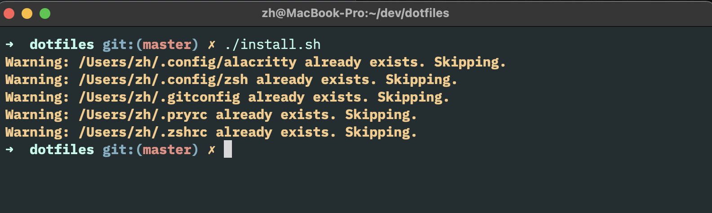

## Preview


## Requirements
- git
- zsh
- oh-my-zsh
- neovim
- homebrew
- alacritty

## Configuration
Check .config/zsh/01-initializers.zsh  
Check .config/zsh/03-user-export.zsh  
Check .gitconfig  

They need to be updated for your personal needs

## Installation
```sh
# install configuration files
# they will be installed in ~/.config/ and symlinked
./install.sh

# install brew packages
xargs brew install < brew_packages.txt
```

### Claude Code
`install.sh` symlinks `claude/` items into `~/.claude/` (settings, statusline, `context-bar` mod) and registers MCP servers from `claude/mcp-servers.json` at user scope.
`CLAUDE.md` lives in [zhisme/prompt](https://github.com/zhisme/prompt). Plugins (caveman) are reinstalled from `enabledPlugins` in `settings.json` on first launch.

## Languages
  * Ruby

    - [rbenv](https://github.com/rbenv/rbenv)

    `rbenv install 3.2.2 && rbenv global 3.2.2`

  * Go

    - [goenv](https://github.com/go-nv/goenv) (installed outside brew; initialized in `.config/zsh/04-plugins.zsh`)

    `goenv install 1.22.0 && goenv global 1.22.0`

  * Node

    - [nvm](https://github.com/nvm-sh/nvm) (installed outside brew; `.nvmrc` auto-switch hook in `.config/zsh/04-plugins.zsh`)

    `nvm install --lts`

### Utilities
  * [rg](https://github.com/BurntSushi/ripgrep)

    ripgrep is a line-oriented search tool that recursively searches the current directory for a regex pattern.
    **Usage**
    ```
    ls / | rg 'myname'
    ```

  * [ag / the_silver_searcher](https://github.com/ggreer/the_silver_searcher)

    Code-search tool, similar to ripgrep.

  * [fzf](https://github.com/junegunn/fzf)

    Command-line fuzzy finder.

  * [lazygit](https://github.com/jesseduffield/lazygit)

    Terminal UI for git.

  * [gh](https://cli.github.com/)

    GitHub CLI.

  * [jq](https://github.com/jqlang/jq)

    Command-line JSON processor.

  * [kubectx / kubens](https://github.com/ahmetb/kubectx)

    Switch between kubectl contexts and namespaces.

  * [tree](https://github.com/Old-Man-Programmer/tree)

    Recursive directory listing.

  * [beads](https://github.com/steveyegge/beads)

    Persistent memory for coding agents — issue/knowledge store your agent reads and writes across sessions.

  * [Zsh](https://www.zsh.org)

    Make your terminal fun again

    **Quick install**
    ```
    brew install zsh
    # make default shell
    sudo -s 'echo /usr/local/bin/zsh >> /etc/shells' && chsh -s /usr/local/bin/zsh
    ```

  * [Oh-my-zsh](https://github.com/robbyrussell/oh-my-zsh)

    Many useful packages, browse /plugins

  * [Diff-so-fancy](https://github.com/so-fancy/diff-so-fancy)

    Better git diff with syntax highlight

  * [Bat](https://github.com/sharkdp/bat)

    Better cat command with syntax highlight

  * [Alacritty](https://alacritty.org/)

    Replacement for default terminal

  * [Homebrew](https://github.com/Homebrew/install)

  * [nvim](https://github.com/neovim/neovim/blob/master/INSTALL.md#install-from-package)

    `brew install nvim`

## Troubleshooting

  * zsh-syntax-highlightning

    If occurs `plugin zsh-syntax-highlighting not found` run the following.

    ```
    git clone https://github.com/zsh-users/zsh-autosuggestions ~/.oh-my-zsh/custom/plugins/zsh-autosuggestions
    git clone https://github.com/zsh-users/zsh-syntax-highlighting.git ~/.oh-my-zsh/custom/plugins/zsh-syntax-highlighting
    ```
